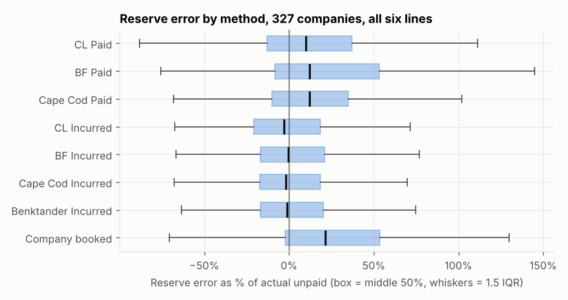
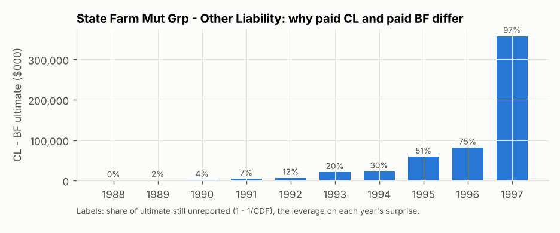
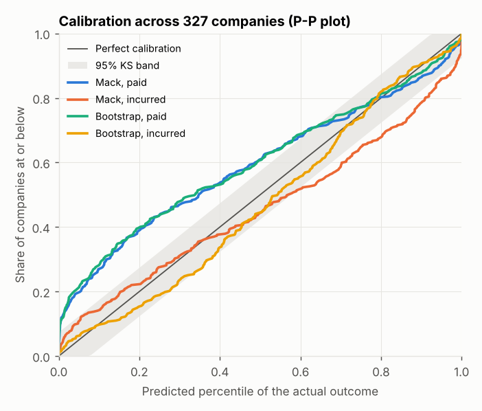

# P&C Loss Reserving Engine on CAS Schedule P Data

A from-scratch reserving engine (NumPy/SciPy, no actuarial libraries) that runs **chain ladder,
Bornhuetter-Ferguson, Cape Cod, Benktander, Mack, and the ODP bootstrap** on real company triangles
from the NAIC Schedule P. It then backtests every method against what actually happened over the
following nine years.

The point of the project is the comparison. The methods don't just give different numbers: each one
fails in its own way, and you can see why in the triangle.

> **Full generated report:** [`reports/REPORT.md`](reports/REPORT.md). It has validation tables,
> three company deep dives, and a backtest of 327 company/line combinations across all six lines.

---

## Headline results

| | |
|---|---|
| **Validation** | Matches published results exactly: Mack (1993) RAA s.e. **26,909**, Taylor-Ashe s.e. **2,447,095**, England-Verrall ODP scale **52,601**, and Mack's (1994) assumption tests. |
| **Most accurate point estimates** | Incurred-based methods. Median reserve error is −3% to 0% for CL / BF / Cape Cod / Benktander on incurred data, against +10% to +12% for the same methods on paid data. |
| **Systematic bias** | **Paid chain ladder over-reserved in every line** (dollar-weighted bias +8% to +35%). Paid-to-incurred ratios show that claims were being settled faster in the 1990s, and a paid triangle can't see that. |
| **Company booked reserves** | Booked reserves were redundant by a median of **+21%**, and by +39% in workers' comp and +48% in med mal (dollar-weighted). On pooled median absolute error, every incurred method beat the company's own booked figure. |
| **Variability models** | Mack and the bootstrap agree closely with each other but are **miscalibrated against reality**. On paid data, 27–28% of outcomes fell below the models' 10th percentile when 10% should. The bias is in the mean, so no extra spread can fix it. |



---

## Data

The source is the **[CAS Loss Reserving Database](https://www.casact.org/publications-research/research/research-resources/loss-reserving-data-pulled-naic-schedule-p)**
(Meyers & Shi), built from NAIC Schedule P Parts 1–4. It has six lines (workers' comp, private
passenger auto, commercial auto, medical malpractice, products liability, other liability), accident
years 1988–1997, and **ten development years for each one**. At the 12/1997 valuation only the upper
triangle was known. The lower triangle (calendar years 1998–2006) is the realised outcome, which is
what makes an honest backtest possible.

The six CSVs in `data/raw/` are the unmodified CAS files. They were retrieved from the
[reservetestr](https://github.com/problemofpoints/reservetestr) mirror because casact.org was not
reachable from the build environment. All 42,845 upper-triangle cells match the independent copy that ships with
`chainladder-python`.

Field conventions follow Meyers (2015):

| Quantity | Definition |
|---|---|
| Paid | `CumPaidLoss` |
| Case incurred | `IncurLoss − BulkLoss` (paid + case reserves) |
| Company booked ultimate | `IncurLoss` (includes the company's own IBNR) |
| Premium | `EarnedPremNet` |
| **Actual ultimate** | case incurred at lag 10 |

**Data screen** (`clean_companies`): positive premium and positive cumulative paid and incurred in
every observed cell, at least $1M of total premium, and some movement after 1997 (a few groups have
frozen lower triangles). That leaves 327 of the 779 company/line triangles.

---

## Methods

All methods live in `reserving/` and are validated in `tests/`.

| Module | Method | Notes |
|---|---|---|
| `chainladder.py` | **Chain ladder** | Volume-weighted age-to-age factors, optional exponential tail |
| `bf.py` | **Bornhuetter-Ferguson** | `U = C + (1 − 1/CDF)·ELR·P` |
| `bf.py` | **Cape Cod** (Stanard-Bühlmann) | ELR = reported ÷ used-up premium Σ P/CDF, so it comes from the company's own data |
| `bf.py` | **Benktander** | BF iterated once; credibility `Z = 1 − (1 − 1/CDF)²` |
| `mack.py` | **Mack (1993)** | Process and parameter s.e. by AY and in total, including the covariance term; Mack's σ² extrapolation for the last age |
| `bootstrap.py` | **ODP bootstrap** (England & Verrall 2002) | Pearson residuals with a DoF adjustment, refit on each pseudo-triangle (parameter risk), gamma process risk with signed handling of negative incrementals; vectorised (10k sims in about 0.2 s) |
| `diagnostics.py` | Why the methods disagree | CL–BF gap decomposition, paid/incurred ratios, actual vs. expected on the latest diagonal, Mack (1994) calendar-year and correlation tests |

**A priori ELR for BF and Benktander.** The prior is the **industry loss ratio by accident year**:
a chain ladder on the line's aggregate triangle across all clean companies. It uses only data known in
1997, and it follows the underwriting cycle year by year instead of applying one flat number.

**One target for everyone.** Every point estimate is scored against case incurred at lag 10. Paid
methods get a paid-to-incurred tail equal to the oldest year's incurred/paid ratio at age 10, which is
on the 1997 diagonal and so known at the valuation date. The variability models are scored on their own
basis (paid models against paid at lag 10), so each one is judged on the quantity it actually models.

---

## Why the methods disagree

All the methods share the same development data, but they make different assumptions about what that
data means. In practice the disagreement comes from four sources.

### 1. Leverage × surprise: chain ladder vs. BF

Every expected-loss method is a credibility blend of the chain ladder ultimate and a prior. A line of
algebra gives the identity at the centre of this project:

```
U_CL − U_BF  =  (1 − 1/CDF)  ×  (U_CL − U_prior)
                 ^ leverage       ^ surprise
```

BF gives the actual emergence credibility `Z = 1/CDF`. When a year is 97% unreported, the chain ladder
multiplies whatever has been paid by 30. BF instead trusts the prior for the 97% that hasn't happened yet.

**State Farm Other Liability, AY 1997.** $21M had been paid by 12/1997 and the paid CDF was **30.6**.
Chain ladder projects $645M, a 161% loss ratio. BF projects $307M. The actual outcome was $329M. In
this triangle, **90% of the total paid CL–BF gap sits in the three most recent accident years**, and
that pattern holds for nearly every company. When CL and BF disagree, the cause is almost always
immature years, and the size of the gap is set by the CDF.



The identity also shows when **BF is the method that's wrong**. For this company the industry prior
(~68%) was far below its actual loss ratios (81–113%), so BF on paid data was 15% light. The two
errors pull in opposite directions, which is why Benktander, sitting between them, came within 2%.
BF is only as good as its prior, and chain ladder is only as good as its CDF.

### 2. Paid vs. incurred: different data, different blind spots

Paid chain ladder assumes **settlement speed is stable**. Incurred chain ladder assumes **case
reserve adequacy is stable**. The ratio of paid to incurred at a fixed age shows which assumption
broke:

* **Rising ratio**: claims are paid faster, or case reserves are set weaker. Paid CL over-projects
  because recent years look more developed than they are.
* **Falling ratio**: payment slows, or case reserves are strengthened. Incurred CL over-projects.

At State Farm Other Liability, the age-1 paid/incurred ratio jumped from 12% (AY 1995) to 25% (AY 1997).
At State Farm PP Auto, the age-2 ratio rose steadily from 78% to 84% (p < 0.01). Both are payment
speed-ups, and in both cases paid CL came in highest of all the methods. Across the whole database,
**paid chain ladder over-reserved in all six lines**, while incurred chain ladder was close to unbiased
(median −3%). This matches Meyers (2015), who traced the paid bias to faster claim settlement during
this period. The Berquist-Sherman adjustments exist for exactly this situation.

### 3. The prior: industry vs. the company's own data

BF and Cape Cod run the same formula and differ only in where the ELR comes from. **Cape Cod**
estimates one flat ELR from the company's own data, weighted toward mature years. In a book whose loss
ratios are trending, that's a problem. State Farm PP Auto's actual loss ratio fell from 87% (AY 1988)
to 68% (AY 1997). Cape Cod's flat 79% overstated every recent year, and **Cape Cod on paid data was
the worst method for that company (+16%)**. BF used the industry prior, which follows the cycle by
year, and was off by +6%. The reverse holds for a company that doesn't look like its industry, like
State Farm Other Liability above, where a company-specific prior would have done better.

### 4. Negative development and management judgement

Scpie Medical Malpractice had **incurred CDFs below 1.0** for AYs 1990–95 (0.94–0.998). Its case
reserves were over-established and later released. Incurred methods picked this up and landed within
±9% of the actual. Paid CL, blind to case reserves, was +48%. The company's own booked ultimate was
**+96%** of the actual unpaid, the most conservative figure of all. That isn't a method error. It shows
the reserve cycle: med mal and workers' comp carriers held large redundancies through the late 1990s
(booked bias +48% and +39%), and the redundancies were released over the following decade. Mack's
calendar-year test flags the incurred triangle (Z = 7, below the 95% band). Its latest diagonal came
in at 0.82–0.84× the expected value for the recent years, so the takedowns were already visible in 1997.

### 5. Mack vs. bootstrap: agreement isn't accuracy

Mack and the ODP bootstrap rest on the same mean structure (volume-weighted chain ladder), so their
centres agree. They differ in the variance assumption. Mack makes variance proportional to the
*cumulative* loss; ODP makes it proportional to the *incremental* mean. On paid data the two give
nearly the same spread (median bootstrap/Mack s.e. ratio 1.06, interquartile range 0.96–1.24). On
incurred data they diverge: incurred incrementals late in development hover around zero, which
inflates the ODP scale parameter, and the bootstrap comes out about 2.6× wider than Mack (median CV
9.4% vs. 3.6%). **Neither one is calibrated against reality:**



| Model, basis | below p10 | p10–p90 | above p90 | median CV (width) |
|---|---|---|---|---|
| Mack, paid | 27% | 59% | 14% | 4.1% |
| Bootstrap, paid | 28% | 60% | 12% | 4.2% |
| Mack, incurred | 14% | 64% | 22% | 3.6% |
| Bootstrap, incurred | 9% | 81% | 9% | 9.4% |
| *ideal* | *10%* | *80%* | *10%* | *as narrow as possible* |

On paid data the two models fail together. Outcomes pile up below the 10th percentile, because the
chain ladder mean is biased high (section 2). Widening the distribution can't fix that. Mack on incurred
data is too narrow in both tails, which Meyers also found. The ODP bootstrap on incurred looks close to
calibrated, but only because it is 2.6× wider. For a handful of companies with negative incurred
development its spread is meaningless. It also still fails a KS test at 5%. Calibration has to be
judged together with sharpness: a model can pass coverage tests just by being uninformative. The lesson: **process and parameter risk are the
smaller part. Model risk, meaning the chance that the development pattern itself changes, dominates,
and no single-model variability estimate captures it.**

---

## What a reserving actuary should take from this

1. **Always run paid and incurred, and then explain the gap between them.** The paid/incurred ratio by
   age is the first diagnostic to check.
2. **Use BF or Benktander for immature years, and pay as much attention to the prior as to the
   development pattern.** When the prior and the development pattern are both uncertain, Benktander
   hedges between them.
3. **Leverage is the risk.** CDF × emerged loss means one unusual payment in AY 1997 moves the
   ultimate 30×.
4. **Treat Mack or bootstrap ranges as lower bounds on uncertainty.** Calibrate them against history
   wherever you can.
5. **Expect booked reserves to differ from any method.** Management margin follows the cycle.

### Translation to health and life reserving

The mechanics carry over directly. Health IBNR **completion factors** are a chain ladder on a
lag triangle by incurred month, and the "paid vs. incurred" problem shows up as changes in claim
processing speed (a backlog or an auto-adjudication change). New products and recent incurred months
are handled with **BF or a PMPM-trend prior**, which is the same leverage × surprise trade-off.
Disability and LTC claim reserves face the same tension between experience and an a priori (table)
assumption that BF formalises. Calibration backtesting like section 3 is what an actuarial-memorandum
reviewer should ask for.

---

## Limitations

* The "actual" ultimate is case incurred at lag 10. Long-tail lines (workers' comp, other liability)
  still had open claims in 2006.
* No tail is fitted beyond age 10 for the variability models, and no Berquist-Sherman or other
  adjustments are made. The point is to show the raw methods' behaviour.
* The industry prior includes the company itself, though it uses only pre-1998 data.
* The bootstrap uses the standard DoF-adjusted residuals rather than hat-matrix (Shapland) adjustments,
  and it doesn't adjust for heteroscedasticity or negative incrementals. ODP is designed for paid data,
  and its incurred results are shown to demonstrate that limitation.
* The data screen's "post-1997 movement" rule looks at outcomes. It removes only six triangles with
  essentially no development after 1997.

---

## Usage

```bash
pip install -r requirements.txt
```

```bash
python -m pytest -q
```

```bash
python -m reserving --lob othliab --list
```

```bash
python -m reserving --lob othliab --company 1767
```

```bash
python scripts/build_report.py
```

The CLI's `--list` option shows clean companies largest first. `--company` runs every method plus
diagnostics on one company. `build_report.py` regenerates `reports/` (takes about 20 s).

As a library:

```python
from reserving.data import company
from reserving.chainladder import chain_ladder
from reserving.bf import bornhuetter_ferguson
from reserving.mack import mack
from reserving.bootstrap import odp_bootstrap

cd = company("wkcomp", 86)                       # Allstate workers' comp
cl = chain_ladder(cd.incurred)
bf = bornhuetter_ferguson(cl, cd.premium, elr=0.70)
m  = mack(cd.paid);  print(m.reserve.sum(), m.total_se)
b  = odp_bootstrap(cd.paid, n_sims=10_000);  print(b.percentile([50, 75, 95]))
```

## Layout

```
reserving/        engine: triangle, chainladder, bf, mack, bootstrap, diagnostics, data, engine, backtest
scripts/          build_report.py (report + figures + CSVs)
reports/          REPORT.md, figures/, backtest_*.csv  (generated)
data/raw/         CAS Schedule P files, one per line
data/benchmarks/  RAA and Taylor-Ashe triangles for validation
tests/            validation against published figures + Schedule P checks
```

## References

* Mack, T. (1993). *Distribution-free calculation of the standard error of chain ladder reserve estimates.* ASTIN Bulletin 23(2).
* Mack, T. (1994). *Measuring the variability of chain ladder reserve estimates.* CAS Forum.
* England, P. & Verrall, R. (2002). *Stochastic claims reserving in general insurance.* British Actuarial Journal 8(3).
* Shapland, M. (2016). *Using the ODP Bootstrap Model: A Practitioner's Guide.* CAS Monograph 4.
* Meyers, G. (2015). *Stochastic Loss Reserving Using Bayesian MCMC Models.* CAS Monograph 1.
* Friedland, J. (2010). *Estimating Unpaid Claims Using Basic Techniques.* CAS.
* Bornhuetter, R. & Ferguson, R. (1972). *The Actuary and IBNR.* PCAS LIX.
