# Reserving engine report

Generated by `scripts/build_report.py` from the CAS Loss Reserving Database (NAIC Schedule P, accident years 1988-1997, valued 12/1997, outcomes through 2006). All amounts in $000s, net of reinsurance. See the [README](../README.md) for method notes and the interpretation of these results.

## 1. Validation against published results

Before touching Schedule P, every method is checked against textbook triangles with known answers (also enforced in `tests/`).

| triangle    | quantity                             | published   | this engine   | source                     |
|:------------|:-------------------------------------|:------------|:--------------|:---------------------------|
| RAA         | Chain ladder reserve                 | 52,135      | 52,135        | Mack (1993)                |
| RAA         | Mack total s.e.                      | 26,909      | 26,909        | Mack (1993); R ChainLadder |
| RAA         | Mack s.e., AY 1990                   | 24,566      | 24,566        | R ChainLadder              |
| Taylor-Ashe | Chain ladder reserve                 | 18,680,856  | 18,680,856    | Mack (1993)                |
| Taylor-Ashe | Mack total s.e.                      | 2,447,095   | 2,447,095     | Mack (1993); R ChainLadder |
| Taylor-Ashe | ODP scale parameter phi              | 52,601      | 52,601        | England & Verrall (2002)   |
| Taylor-Ashe | Bootstrap prediction error / reserve | ~16%        | 16.1%         | England & Verrall (2002)   |

Mack's (1994) assumption tests on RAA: calendar-year statistic Z = 14 (E[Z] = 12.875); adjacent-factor correlation T = 0.070 (50% band ±0.127), matching the paper.

## 2. Company deep dives

### 2.1 State Farm Mut Grp - Other Liability (NAIC group 1767)

*Methods disagree: long tail, a shifting payment pattern.*

Net earned premium AY 1988-97: 2,414,413k. Paid to date at 12/1997: 1,409,719k.

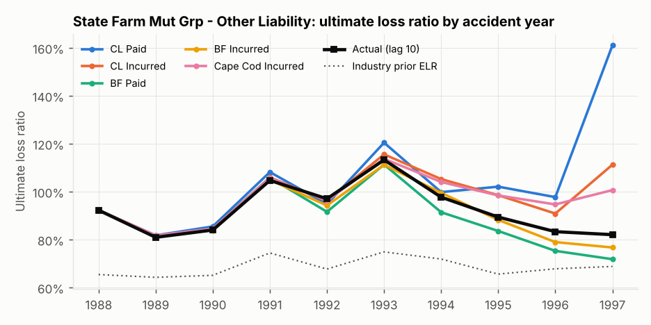

**Point estimates (all measured against case incurred at lag 10, $000)**

| method              |   ultimate |    unpaid |    error | error / actual unpaid   |
|:--------------------|-----------:|----------:|---------:|:------------------------|
| CL Paid             |  2,643,224 | 1,233,505 |  436,070 | +54.7%                  |
| BF Paid             |  2,090,327 |   680,608 | -116,827 | -14.7%                  |
| Cape Cod Paid       |  2,393,780 |   984,061 |  186,626 | +23.4%                  |
| Benktander Paid     |  2,194,908 |   785,189 |  -12,246 | -1.5%                   |
| CL Incurred         |  2,407,897 |   998,178 |  200,743 | +25.2%                  |
| BF Incurred         |  2,162,080 |   752,361 |  -45,074 | -5.7%                   |
| Cape Cod Incurred   |  2,371,969 |   962,250 |  164,815 | +20.7%                  |
| Benktander Incurred |  2,258,761 |   849,042 |   51,607 | +6.5%                   |
| Company booked      |  2,279,145 |   869,426 |   71,991 | +9.0%                   |
| Actual (lag 10)     |  2,207,154 |   797,435 |        0 | +0.0%                   |

**Where the disagreement comes from, by accident year**

|   AY | % unreported (paid)   |   paid CL - BF | % unreported (inc)   |   incurred CL - BF |   actual ult |
|-----:|:----------------------|---------------:|:---------------------|-------------------:|-------------:|
| 1988 | 0%                    |             34 | 0%                   |                  0 |      128,036 |
| 1989 | 2%                    |            487 | 0%                   |                131 |      132,138 |
| 1990 | 4%                    |          1,468 | 2%                   |                639 |      136,285 |
| 1991 | 7%                    |          4,203 | 3%                   |              1,861 |      185,765 |
| 1992 | 12%                   |          6,268 | 7%                   |              3,758 |      191,954 |
| 1993 | 20%                   |         20,544 | 11%                  |              9,805 |      255,365 |
| 1994 | 30%                   |         22,468 | 17%                  |             15,332 |      261,483 |
| 1995 | 51%                   |         58,877 | 31%                  |             32,745 |      284,723 |
| 1996 | 75%                   |         81,475 | 52%                  |             43,287 |      302,840 |
| 1997 | 97%                   |        357,074 | 81%                  |            138,260 |      328,565 |

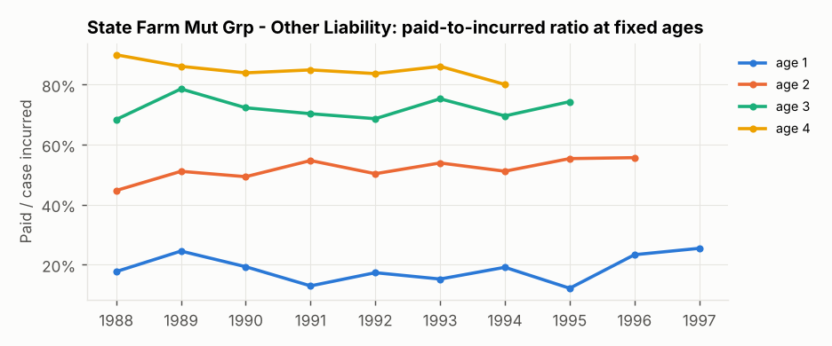

**Diagnostics**

- Premium changed +189% from AY 1988 to AY 1997.
- 90% of the paid CL - BF gap sits in the three most recent accident years.
- Paid-to-incurred ratio at fixed ages, oldest to newest AY: age 1: 18% -> 25% (p = 0.65); age 2: 45% -> 56% (p = 0.02); age 3: 68% -> 74% (p = 0.94).
- Calendar-year effect test (Mack 1994): paid Z = 11 vs 95% band [8.9, 16.1]; incurred Z = 10 vs 95% band [8.9, 16.4].
- Adjacent-factor correlation test: paid T = 0.18 **flagged**; incurred T = 0.08.
- Actual vs expected on the 1997 diagonal - paid: latest diagonal came in at 0.964x what the 1996 factors predicted (by AY: 1.02, 1.00, 1.04, 1.02, 0.98, 1.01, 0.98, 0.63); incurred: latest diagonal came in at 0.980x what the 1996 factors predicted (by AY: 1.02, 0.98, 1.03, 0.99, 0.95, 1.04, 1.02, 0.83).
- Paid tail used to reach incurred: 1.001 (AY 1988 incurred/paid at age 10).

**Variability (each model judged on its own basis, lag 10, no tail)**

| basis    |   CL development |   Mack s.e. |   bootstrap mean |   bootstrap s.e. | boot 5th-95th       |   actual | actual pct (Mack)   | actual pct (boot)   |
|:---------|-----------------:|------------:|-----------------:|-----------------:|:--------------------|---------:|:--------------------|:--------------------|
| paid     |        1,231,110 |     178,437 |        1,242,227 |          177,824 | 990,498 - 1,566,856 |  780,896 | 0%                  | 0%                  |
| incurred |          729,948 |      90,546 |          736,138 |           96,643 | 586,301 - 902,900   |  529,205 | 1%                  | 1%                  |

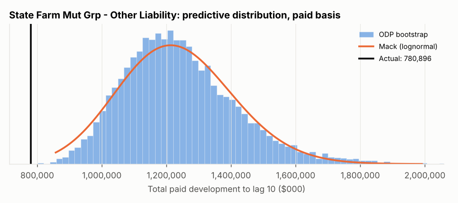

### 2.2 Scpie Indemnity Co - Medical Malpractice (NAIC group 669)

*Methods disagree, and the company was further off than any of them.*

Net earned premium AY 1988-97: 1,049,205k. Paid to date at 12/1997: 705,355k.

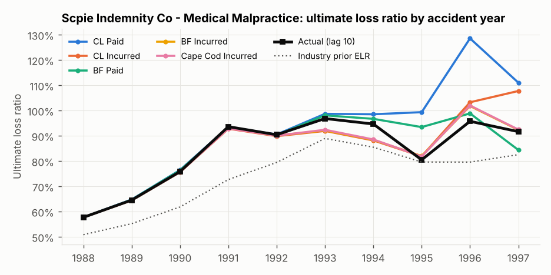

**Point estimates (all measured against case incurred at lag 10, $000)**

| method              |   ultimate |   unpaid |   error | error / actual unpaid   |
|:--------------------|-----------:|---------:|--------:|:------------------------|
| CL Paid             |    951,234 |  245,879 |  79,974 | +48.2%                  |
| BF Paid             |    883,123 |  177,768 |  11,863 | +7.2%                   |
| Cape Cod Paid       |    891,065 |  185,710 |  19,805 | +11.9%                  |
| Benktander Paid     |    903,901 |  198,546 |  32,641 | +19.7%                  |
| CL Incurred         |    885,007 |  179,652 |  13,747 | +8.3%                   |
| BF Incurred         |    867,788 |  162,433 |  -3,472 | -2.1%                   |
| Cape Cod Incurred   |    868,212 |  162,857 |  -3,048 | -1.8%                   |
| Benktander Incurred |    874,705 |  169,350 |   3,445 | +2.1%                   |
| Company booked      |  1,030,039 |  324,684 | 158,779 | +95.7%                  |
| Actual (lag 10)     |    871,260 |  165,905 |       0 | +0.0%                   |

**Where the disagreement comes from, by accident year**

|   AY | % unreported (paid)   |   paid CL - BF | % unreported (inc)   |   incurred CL - BF |   actual ult |
|-----:|:----------------------|---------------:|:---------------------|-------------------:|-------------:|
| 1988 | 1%                    |             53 | 0%                   |                  0 |       78,104 |
| 1989 | 1%                    |             71 | 0%                   |                  0 |       72,259 |
| 1990 | 1%                    |            128 | -0%                  |                -26 |       75,276 |
| 1991 | 1%                    |            248 | -1%                  |               -199 |       90,343 |
| 1992 | 2%                    |            257 | -3%                  |               -260 |       89,164 |
| 1993 | 6%                    |            599 | -5%                  |               -146 |       96,008 |
| 1994 | 14%                   |          1,757 | -7%                  |               -178 |       91,927 |
| 1995 | 30%                   |          6,004 | -6%                  |               -130 |       81,782 |
| 1996 | 61%                   |         30,160 | 6%                   |              1,502 |       97,228 |
| 1997 | 93%                   |         28,834 | 61%                  |             16,656 |       99,169 |

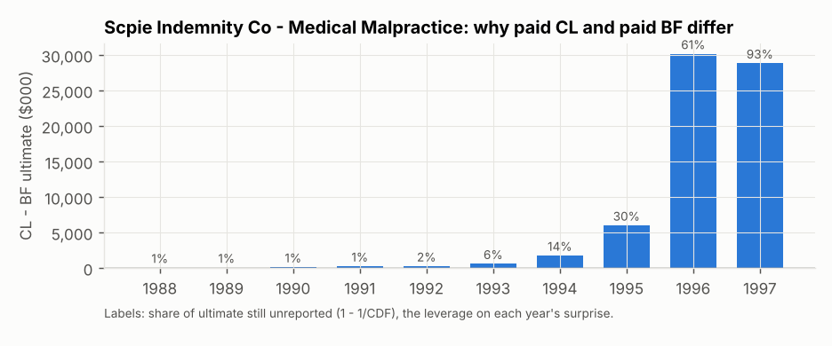

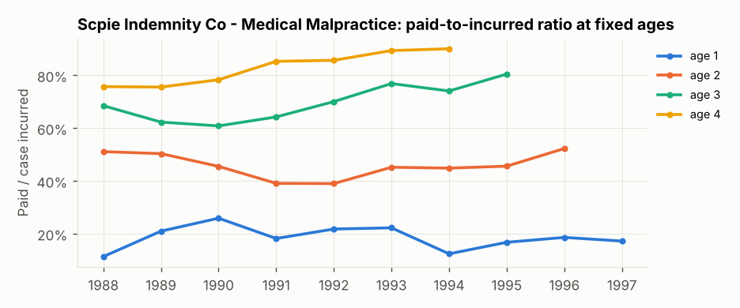

**Diagnostics**

- Premium changed -20% from AY 1988 to AY 1997.
- 95% of the paid CL - BF gap sits in the three most recent accident years.
- Paid-to-incurred ratio at fixed ages, oldest to newest AY: age 1: 11% -> 17% (p = 0.77); age 2: 51% -> 52% (p = 0.91); age 3: 69% -> 80% (p = 0.01).
- Calendar-year effect test (Mack 1994): paid Z = 9 vs 95% band [8.9, 16.4]; incurred Z = 7 vs 95% band [8.9, 16.4] **flagged**.
- Adjacent-factor correlation test: paid T = 0.51 **flagged**; incurred T = 0.36 **flagged**.
- Actual vs expected on the 1997 diagonal - paid: latest diagonal came in at 0.972x what the 1996 factors predicted (by AY: 0.99, 1.00, 1.01, 0.97, 0.97, 0.95, 0.93, 0.95); incurred: latest diagonal came in at 0.946x what the 1996 factors predicted (by AY: 1.00, 1.01, 1.01, 1.02, 1.01, 0.95, 0.82, 0.84).
- Paid tail used to reach incurred: 1.006 (AY 1988 incurred/paid at age 10).

**Variability (each model judged on its own basis, lag 10, no tail)**

| basis    |   CL development |   Mack s.e. |   bootstrap mean |   bootstrap s.e. | boot 5th-95th     |   actual | actual pct (Mack)   | actual pct (boot)   |
|:---------|-----------------:|------------:|-----------------:|-----------------:|:------------------|---------:|:--------------------|:--------------------|
| paid     |          240,423 |      30,156 |          242,566 |           44,241 | 176,494 - 320,300 |  164,633 | 0%                  | 2%                  |
| incurred |           59,362 |      43,725 |           65,292 |           85,259 | -52,270 - 211,131 |   45,615 | 39%                 | 44%                 |

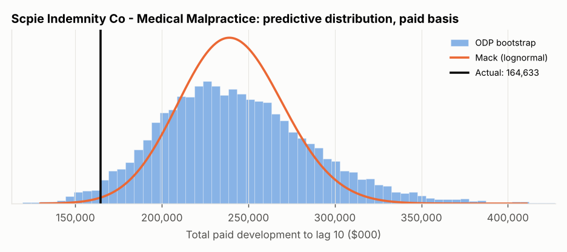

### 2.3 State Farm Mut Grp - Private Passenger Auto Liability (NAIC group 1767)

*Methods agree on the point estimate; the variability models are still too confident.*

Net earned premium AY 1988-97: 117,655,840k. Paid to date at 12/1997: 79,798,868k.

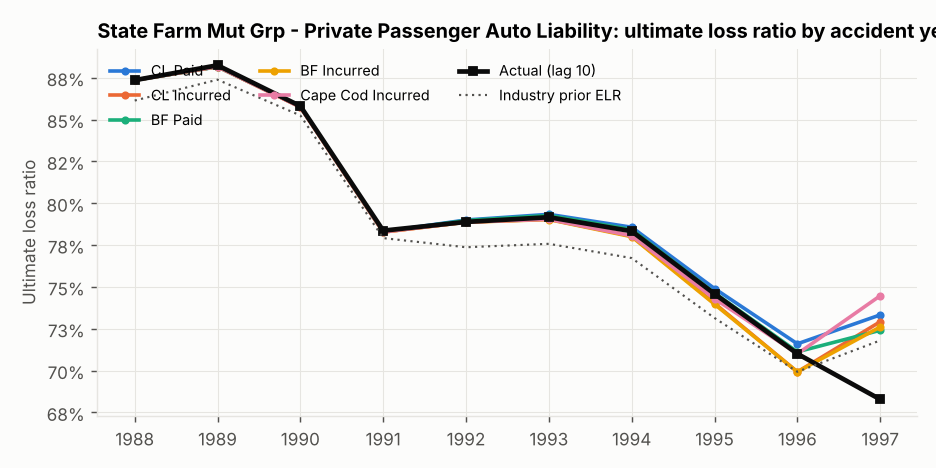

**Point estimates (all measured against case incurred at lag 10, $000)**

| method              |   ultimate |     unpaid |     error | error / actual unpaid   |
|:--------------------|-----------:|-----------:|----------:|:------------------------|
| CL Paid             | 92,468,158 | 12,669,290 |   935,756 | +8.0%                   |
| BF Paid             | 92,192,029 | 12,393,161 |   659,627 | +5.6%                   |
| Cape Cod Paid       | 93,447,024 | 13,648,156 | 1,914,622 | +16.3%                  |
| Benktander Paid     | 92,357,742 | 12,558,874 |   825,340 | +7.0%                   |
| CL Incurred         | 91,911,951 | 12,113,083 |   379,549 | +3.2%                   |
| BF Incurred         | 91,848,602 | 12,049,734 |   316,200 | +2.7%                   |
| Cape Cod Incurred   | 92,339,846 | 12,540,978 |   807,444 | +6.9%                   |
| Benktander Incurred | 91,898,281 | 12,099,413 |   365,879 | +3.1%                   |
| Company booked      | 92,235,864 | 12,436,996 |   703,462 | +6.0%                   |
| Actual (lag 10)     | 91,532,402 | 11,733,534 |         0 | +0.0%                   |

**Where the disagreement comes from, by accident year**

|   AY | % unreported (paid)   |   paid CL - BF | % unreported (inc)   |   incurred CL - BF |   actual ult |
|-----:|:----------------------|---------------:|:---------------------|-------------------:|-------------:|
| 1988 | 0%                    |             85 | 0%                   |                  0 |    6,821,730 |
| 1989 | 0%                    |            129 | 0%                   |                 11 |    7,734,168 |
| 1990 | 0%                    |            247 | 0%                   |                 61 |    8,405,744 |
| 1991 | 1%                    |            392 | 0%                   |                122 |    8,302,581 |
| 1992 | 2%                    |          3,608 | 1%                   |              1,208 |    9,038,507 |
| 1993 | 4%                    |          8,309 | 1%                   |              2,652 |    9,690,326 |
| 1994 | 8%                    |         18,580 | 3%                   |              5,116 |   10,400,552 |
| 1995 | 15%                   |         36,971 | 6%                   |              7,669 |   10,535,569 |
| 1996 | 29%                   |         70,285 | 13%                  |                -98 |   10,413,037 |
| 1997 | 60%                   |        137,524 | 28%                  |             46,608 |   10,190,188 |

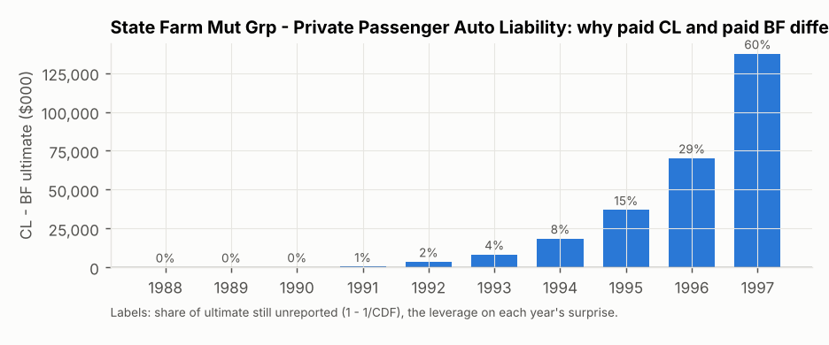

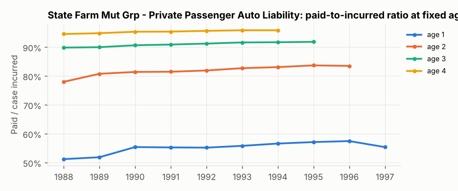

**Diagnostics**

- Premium changed +91% from AY 1988 to AY 1997.
- 89% of the paid CL - BF gap sits in the three most recent accident years.
- Paid-to-incurred ratio at fixed ages, oldest to newest AY: age 1: 51% -> 55% (p = 0.01); age 2: 78% -> 84% (p = 0.00); age 3: 90% -> 92% (p = 0.00).
- Calendar-year effect test (Mack 1994): paid Z = 5 vs 95% band [8.9, 16.4] **flagged**; incurred Z = 4 vs 95% band [8.9, 16.1] **flagged**.
- Adjacent-factor correlation test: paid T = 0.92 **flagged**; incurred T = 0.31 **flagged**.
- Actual vs expected on the 1997 diagonal - paid: latest diagonal came in at 0.987x what the 1996 factors predicted (by AY: 1.00, 1.00, 1.00, 1.00, 1.00, 0.99, 0.98, 0.93); incurred: latest diagonal came in at 0.993x what the 1996 factors predicted (by AY: 1.00, 1.00, 1.00, 1.00, 1.00, 1.00, 1.00, 0.95).
- Paid tail used to reach incurred: 1.001 (AY 1988 incurred/paid at age 10).

**Variability (each model judged on its own basis, lag 10, no tail)**

| basis    |   CL development |   Mack s.e. |   bootstrap mean |   bootstrap s.e. | boot 5th-95th           |     actual | actual pct (Mack)   | actual pct (boot)   |
|:---------|-----------------:|------------:|-----------------:|-----------------:|:------------------------|-----------:|:--------------------|:--------------------|
| paid     |       12,586,821 |     550,736 |       12,622,385 |          472,526 | 11,837,280 - 13,394,136 | 11,561,327 | 3%                  | 1%                  |
| incurred |        5,521,848 |     387,080 |        5,554,189 |          367,790 | 4,955,718 - 6,168,842   |  5,142,299 | 16%                 | 13%                 |

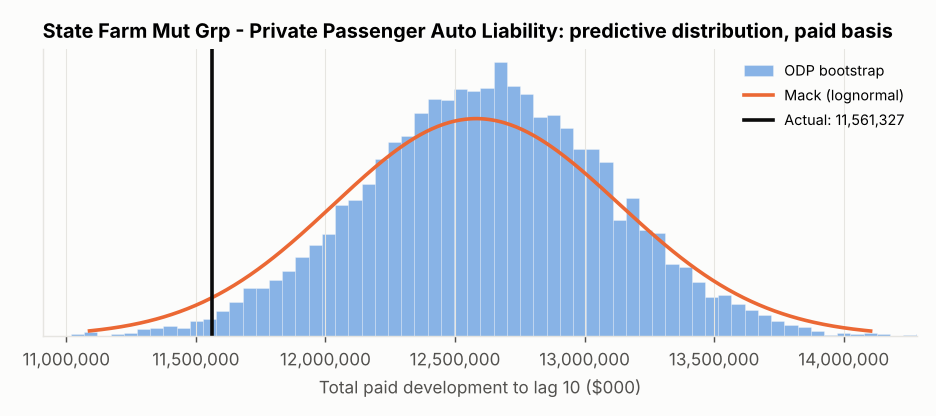

## 3. Backtest: every clean company in the database

327 company/line combinations pass the data screen (`reserving.data.clean_companies`). For each one the 1997 upper triangles are run through every method and the estimate is compared with the realised lag-10 outcome. Errors are quoted as a share of the actual unpaid amount, i.e. *how wrong the reserve would have been*.

**All lines pooled (equal weight per company)**

|                     | median error   | median |error|   | within ±20%   | closest estimate   |
|:--------------------|:---------------|:-----------------|:--------------|:-------------------|
| CL Paid             | +10%           | 25%              | 42%           | 12%                |
| BF Paid             | +12%           | 22%              | 45%           | 14%                |
| Cape Cod Paid       | +12%           | 25%              | 40%           | 11%                |
| Benktander Paid     | +11%           | 22%              | 46%           | 11%                |
| CL Incurred         | -3%            | 19%              | 51%           | 9%                 |
| BF Incurred         | -0%            | 19%              | 53%           | 12%                |
| Cape Cod Incurred   | -2%            | 18%              | 55%           | 9%                 |
| Benktander Incurred | -1%            | 19%              | 53%           | 7%                 |
| Company booked      | +21%           | 27%              | 37%           | 16%                |

**Dollar-weighted bias by line** (sum of errors / sum of actual unpaid; positive = over-reserved)

| method              | wkcomp (n=56)   | ppauto (n=86)   | comauto (n=81)   | medmal (n=11)   | prodliab (n=13)   | othliab (n=80)   |
|:--------------------|:----------------|:----------------|:-----------------|:----------------|:------------------|:-----------------|
| CL Paid             | +9%             | +11%            | +8%              | +11%            | +32%              | +35%             |
| BF Paid             | +3%             | +7%             | -2%              | -0%             | -2%               | +4%              |
| Cape Cod Paid       | +17%            | +17%            | +2%              | -5%             | -2%               | +15%             |
| Benktander Paid     | +6%             | +9%             | +1%              | +5%             | +4%               | +8%              |
| CL Incurred         | -5%             | +2%             | -13%             | -5%             | +7%               | +11%             |
| BF Incurred         | -5%             | +1%             | -17%             | -10%            | -5%               | -3%              |
| Cape Cod Incurred   | -2%             | +5%             | -12%             | -7%             | -3%               | +9%              |
| Benktander Incurred | -5%             | +2%             | -11%             | -5%             | -1%               | +2%              |
| Company booked      | +39%            | +7%             | -0%              | +48%            | -8%               | +21%             |

**Median absolute error by line**

| method              | wkcomp (n=56)   | ppauto (n=86)   | comauto (n=81)   | medmal (n=11)   | prodliab (n=13)   | othliab (n=80)   |
|:--------------------|:----------------|:----------------|:-----------------|:----------------|:------------------|:-----------------|
| CL Paid             | 23%             | 22%             | 25%              | 39%             | 20%               | 36%              |
| BF Paid             | 20%             | 16%             | 22%              | 21%             | 68%               | 52%              |
| Cape Cod Paid       | 25%             | 24%             | 23%              | 19%             | 33%               | 25%              |
| Benktander Paid     | 22%             | 20%             | 19%              | 20%             | 33%               | 32%              |
| CL Incurred         | 18%             | 12%             | 20%              | 24%             | 26%               | 28%              |
| BF Incurred         | 18%             | 12%             | 19%              | 31%             | 19%               | 31%              |
| Cape Cod Incurred   | 19%             | 12%             | 15%              | 30%             | 19%               | 25%              |
| Benktander Incurred | 18%             | 12%             | 20%              | 33%             | 21%               | 29%              |
| Company booked      | 42%             | 20%             | 19%              | 42%             | 37%               | 43%              |

**Calibration of the variability models** (a calibrated model puts 10% of outcomes below its 10th percentile, 80% inside the 10-90 band and 10% above; KS p-value tests uniform percentiles; median_cv = s.e. / ultimate, i.e. how wide the model is)

|                                  |   n | below_p10   | inside_p10_p90   | above_p90   | median_pct   |   ks_pvalue | median_cv   |
|:---------------------------------|----:|:------------|:-----------------|:------------|:-------------|------------:|:------------|
| ('Mack (lognormal)', 'paid')     | 327 | 27%         | 59%              | 14%         | 35%          |       0     | 4.1%        |
| ('Mack (lognormal)', 'incurred') | 327 | 14%         | 64%              | 22%         | 57%          |       0     | 3.6%        |
| ('ODP bootstrap', 'paid')        | 327 | 28%         | 60%              | 12%         | 34%          |       0     | 4.2%        |
| ('ODP bootstrap', 'incurred')    | 327 | 9%          | 81%              | 9%          | 54%          |       0.015 | 9.4%        |

